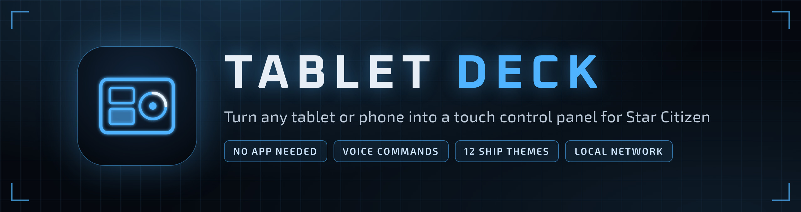
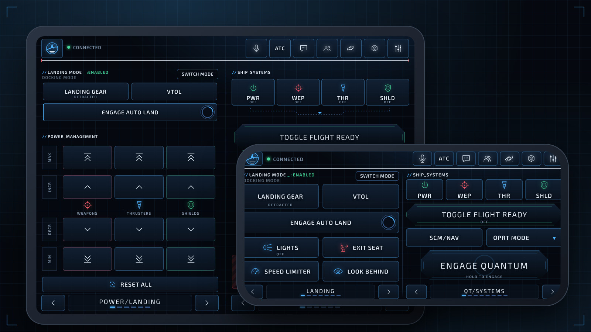
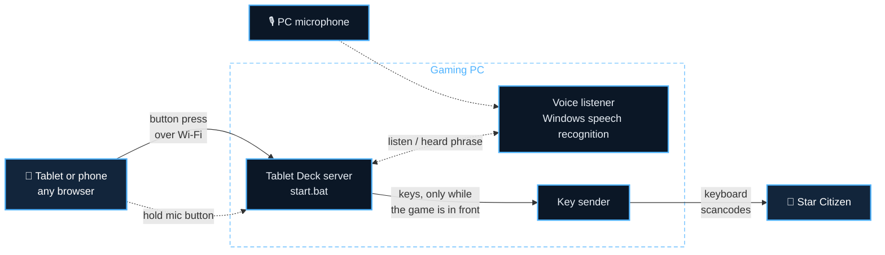
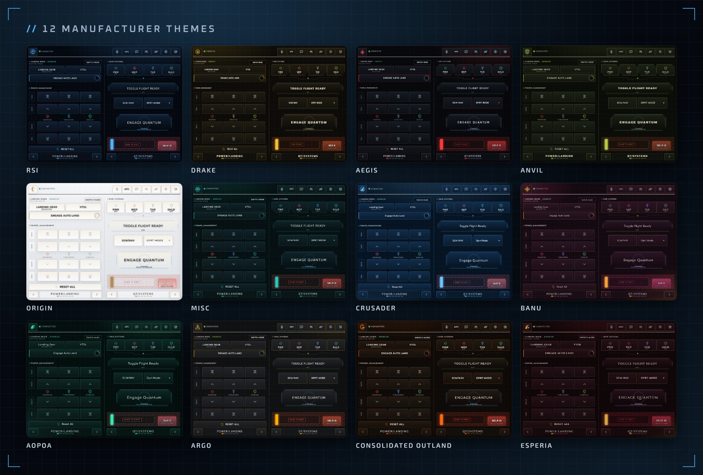

<p align="center">
  
</p>

Turn any tablet into a touch control panel for Star Citizen. A small server on
your gaming PC serves a HUD-style button deck to the tablet over your home
network, and each button sends real keyboard scancodes that Star Citizen reads.

<p align="center">
  
</p>

- 1024×768 two-panel HUD with landing, power management, quantum, operator
  modes, shields, targeting, salvage, mining, doors, emotes and more
- 12 ship-manufacturer themes (RSI, Drake, Aegis, Anvil, Origin, MISC, Crusader,
  Banu, Aopoa, Argo, Consolidated Outland, Esperia)
- Press animations: landing-gear struts, quantum charge ring, decoy sparks,
  lock-on brackets, sliding doors, slide-to-eject and more
- Works in any tablet browser (iPad or Android), no app or account needed
- Phone layout sized for the iPhone 15 Pro in landscape; every layout stretches
  to fill the whole screen
- Hold-to-talk voice commands ("engines on", "landing gear", "engage quantum")
- Animated intro screen: the manufacturer emblem draws itself, then tap to
  quantum-jump into the deck

> Fan project. Not affiliated with or endorsed by Cloud Imperium Games. Star
> Citizen and the manufacturer names belong to their owners; the emblems here
> are original designs, not the companies' logos.

## How it works



The tablet only shows the buttons; everything else happens on the PC. A press
travels over your home network to the server, which checks that Star Citizen
is the window in front and has the key sender type the button's keys. Voice
commands take the same path once the PC has recognised the phrase.

## Requirements

- Windows 10 or 11 on the gaming PC
- [Node.js](https://nodejs.org) 18 or newer
- A tablet on the same Wi-Fi or network as the PC

Nothing else to install. The key sender (`native/keysender.cs`) compiles itself
on first run with the C# compiler that ships with Windows.

## Setup

1. Download this repository (**Code → Download ZIP**, then extract it) or clone it.
2. Double-click `start.bat`.
3. When Windows Firewall asks whether Node.js may use the network, allow
   **Private networks**.
4. The window prints an address and a pairing code, for example
   `http://192.168.1.20:8765` and `Pairing code: 1a2b3c4d`, plus a QR code.
   Scan the QR code with the tablet's camera, or open the address on your tablet
   and enter the code. Use "Add to Home Screen" for a full-screen app.
5. Click into Star Citizen. Buttons only press keys while Star Citizen is the
   window in front; otherwise the tablet shows "Star Citizen not focused" and
   nothing is typed into the other window.

The tablet's screen stays on while the deck is open, so it doesn't dim or lock
mid-flight. "Add to Home Screen" gives the deck its own icon and, on iPad and
iPhone, opens it full screen. On Android, Chrome only makes full-screen apps
from `https` pages, so there the shortcut opens in a browser tab.

`start.bat --dry-run` logs button presses without sending any keys, which is
handy for trying the deck out. Dry runs skip the focus check.

### Showcase / sandbox

To show or test the deck without a phone, and without pressing keys in the
game, run a dry-run copy on another port and open the showcase page on the PC:

```
node server.js --dry-run --port 8790
```

Then open `http://localhost:8790/showcase.html?t=<pairing code>`. It shows the
deck inside an iPhone 15 Pro frame (852×393, landscape) or, with the toggle, an
iPad frame (1024×768). Clicks work as taps. The phone frame passes the iPhone's
safe-area insets (`&safe=0,59,21,59`) so the deck stays clear of the Dynamic
Island and home indicator as on the real phone. Pages inside a frame always see
zero insets otherwise.

Next to the device, a live log shows each button's label, its keys, and how it
was pressed (tap, long press, hold and release, or voice). It also shows voice
results and whether the focus check would have blocked the press. The press
still goes through, because it's a dry run. Mode switches and panel arrows
appear as "screen only", since they send nothing to the PC. The log comes from
`/events`, which only exists in `--dry-run` and needs the pairing code. Against
a normal server the page warns that taps send real keys.

In Claude Code, `.claude/launch.json` has this as the **deck-sandbox** config,
so the built-in browser can start it with `preview_start`.

## Keybinds

The deck uses Star Citizen 4.x default keys where they exist. Actions with no
default keyboard key (operator modes, shield facings, doors, emotes, targeting
and so on) get keys from the **Tablet Deck Keyboard** profile in
`keybinds/TabletDeck-StarCitizen.xml`. Load it in Star Citizen once:

1. Copy `keybinds/TabletDeck-StarCitizen.xml` into
   `StarCitizen\LIVE\user\client\0\Controls\Mappings` (create the `Mappings`
   folder if it doesn't exist).
2. In-game, open **Options → Keybindings → Control Profiles** and load
   **Tablet Deck Keyboard**. This replaces your current custom binds, so note
   any you want to keep and set them again afterwards.

The server reads the profile and your own `actionmaps.xml`, and your file wins.
If you rebind an action in-game, its button follows. The server looks for
`actionmaps.xml` in the usual install folders; if yours is elsewhere, set the
path in `config.json` (see Settings).

Buttons marked `"verify": true` in the layout use Star Citizen defaults that the
profile doesn't set (power management, system power toggles, SCM/NAV, eject,
chat, docking camera). Check those against your keybinding screen.

The mining buttons are marked too: the profile binds them to keys, but their
Star Citizen action names couldn't be confirmed against the game's files. After
loading the profile, check that **Options → Keybindings → Vehicles → Mining**
shows Fire Laser on RCtrl+F, Fracture/Extract on RCtrl+T, laser power on
RCtrl+W / RCtrl+S and the modules on LAlt+1-3. If one is missing, the game
didn't recognise that action; rebind it there to the same key.

### Rebuilding the profile

The profile is generated from the layouts. After you add or change a button
that has an `scAction`, rebuild the profile, then copy it and load it in-game
again:

```
node tools/make-profile.js
```

Every `scAction` must be listed with its Star Citizen actionmap in `ACTIONMAPS`
at the top of `tools/make-profile.js`. The script stops if an action is missing
there, if two buttons give the same action different keys, or if two actions
that are active at the same time share a key.
`node tools/make-profile.js --check` only reports whether the committed file is
up to date.

## Layouts

`config.json` → `layout` picks what the tablet shows:

- `layouts/hud.json` (default): the 1024×768 two-half HUD. Each half
  pages through panels with the arrows at the bottom: POWER/LANDING, Flight
  Assist, Shields, Targeting, Salvage and Mining on the left; QT/SYSTEMS, Operator
  Modes, Combat, Crew/Doors, On Foot and Emotes on the right.
- `layouts/star-citizen.json`: a simpler tabbed grid of buttons.

### Phones

Phones get their own layout automatically (`config.json` → `phoneLayout`,
default `layouts/hud-phone.json`). It is sized for an iPhone 15 Pro in
landscape: a 734×372 canvas, which is the 852×393 screen minus the Dynamic
Island and home indicator, so it shows at full size when opened from the home
screen. Other phones scale it to fit. The same panels are there, re-flowed for
the shorter screen (Landing and Power on the left; QT/Systems, Emergency and the
rest on the right). Hold the phone sideways; in portrait it asks you to turn it.

The page counts any screen whose short side is under 500 points as a phone. Add
`&device=tablet` or `&device=phone` to the address to override that.

The phone layout is generated from the tablet one, so keys and animations match.
After editing `layouts/hud.json`, run `node tools/make-phone-layout.js`.

Canvas layouts place each element at `x`, `y`, `w`, `h` in canvas pixels (panel
elements are relative to their half). Element types include `button`, `header`,
`switch` (with `when` to show elements per mode), `menu`, `slider`, `grid` and
decorations.

## Changing buttons

Edit a layout file, then reload the page on the tablet. Button fields:

| field      | meaning |
|------------|---------|
| `keys`     | Star Citizen key names joined with `+`: `r`, `lalt+n`, `np_1`, `f5`, `ralt+y` |
| `mode`     | `tap` (quick press), `hold` (held while your finger is down), `timed` (held for `ms`) |
| `color`    | `green`, `amber`, `red`, `blue` or blank (uses the theme's accent) |
| `icon`     | icon name from `public/icons.js`; defaults to the button `id` |
| `anim`     | press animation: `flash`, `ripple`, `gear`, `charge`, `burst`, `glow`, `recoil`, `streak`, `doors`, `lock`, `hazard`, `timed` |
| `scAction` | Star Citizen action name; if a keybind file in `actionmaps` binds it to a key, that key wins. Listed in the keybind profile (see Keybinds) |

Key names: `a`-`z`, `0`-`9`, `f1`-`f24`, `np_0`-`np_9`, `np_period`, `np_add`,
`np_subtract`, `np_multiply`, `np_divide`, `np_enter`, `lalt`, `ralt`, `lctrl`,
`rctrl`, `lshift`, `rshift`, `space`, `tab`, `enter`, `escape`, `backspace`,
`insert`, `delete`, `home`, `end`, `pgup`, `pgdn`, `up`, `down`, `left`, `right`.

## Voice commands

Hold the mic button at the top of the deck, say a command, and let go. The PC
listens with Windows' built-in speech recognition (offline, no account) through
your default microphone, then presses that button's keys. The tablet shows what
it heard, or "Didn't catch that".

- Every button answers to its name ("landing gear", "fire laser", "max
  shields"; `+` and `−` are said as "up" and "down", so "shields up").
- Common commands have extra phrases: "engines on", "disable shields", "gear
  up", "flight ready", "engage quantum", "lights on", "flares", "doors" and more.
  They're in the `"voice"` lists in `layouts/hud.json`; add your own
  there.
- Most Star Citizen controls are toggles, so "engines on" and "engines off"
  press the same key. The deck can't see the game, so it can't tell which state
  you're in.
- Eject, self-destruct and look behind don't respond to voice.
- The focus check applies: nothing is pressed unless Star Citizen is in front.

Commands are in English and need the English speech recognizer in Windows. If
the PC window says "no en-US speech recognizer installed", add it under
**Settings → Time & Language → Speech** (or Language → English → Options →
Speech recognition), then restart `start.bat`. If commands are often missed or
misheard, try a headset mic, or change `voiceConfidence` (see Settings).

## Themes

Tap the sliders button (top right) to pick a manufacturer theme. Each tablet
remembers its own choice. **Night mode** in the same screen dims the whole deck
for playing in a dark room. Themes are CSS variables in `public/themes.css`; add
one by copying a block there and adding an entry to `THEMES` in `public/app.js`.
Theme fonts come from Google Fonts; without internet access the tablet falls
back to system fonts.

<p align="center">
  
</p>

## Settings (`config.json`, created on first run)

- `port`: server port (default 8765).
- `token`: the pairing code. Change it to anything you like, or delete it to
  generate a new random one. Restart the server afterwards.
- `layout`: which layout file to serve to tablets and PCs.
- `phoneLayout`: which layout file to serve to phones.
- `actionmaps`: keybind files to read, in order (later files win). Defaults to
  `keybinds/TabletDeck-StarCitizen.xml`, then your Star Citizen `actionmaps.xml`.
- `tapMs`: how long a tap holds the key (default 60 ms).
- `onlyWhenGameFocused`: only press keys while Star Citizen (`StarCitizen.exe`)
  is the window in front (default `true`). Set it to `false` to send keys to
  whichever window is in front, e.g. to try buttons out in Notepad.
- `voice`: voice commands on or off (default `true`).
- `voiceLanguage`: the Windows speech recognizer to use (default `en-US`; any
  other English one works too if that's what's installed).
- `voiceConfidence`: how sure the recognizer must be before a command counts,
  from 0 to 1 (default 0.6). Raise it if it triggers on the wrong things, lower
  it if it often says "Didn't catch that".

## Safety

- Only devices with the pairing code can press keys. Keep the server on your
  home network; don't expose its port to the internet.
- Held keys are released if the tablet disconnects or goes quiet for 5 seconds.
- Presses are skipped while another window is in front (see
  `onlyWhenGameFocused`). Releasing a held button always goes through, so
  switching windows mid-hold doesn't leave a key stuck down in the game.
- If Star Citizen runs as administrator, run `start.bat` as administrator too.
  Windows blocks keypresses from a normal program into an elevated one.
